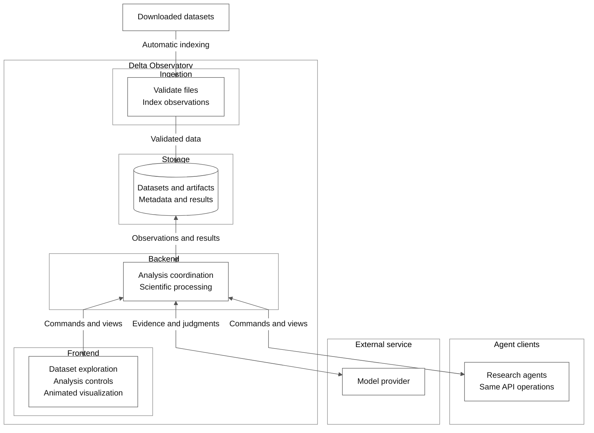

# Delta Observatory system design

Status: target design for review.

Delta Observatory is an interactive platform for investigating astronomical observations, measurable signals, changes, and candidate discoveries.
The finished system combines scientific processing, animated visualization, reproducible analysis, and decision assistance.
Richard can inspect and change the scientific assumptions that govern an investigation.

This specification describes the finished system. It does not prescribe implementation stages or authorize construction.
The specification distinguishes system requirements from proposed implementation choices.
Unresolved scientific choices require review with Richard.

**Purpose and scope**

The system turns downloaded astronomical datasets into inspectable measurements and candidate objects or events.
It supports exploration before analysis, controlled experiments with analysis parameters, and investigations across compatible datasets.

The dataset catalog in `datasets/` defines the available collections and their acquisition requirements.
The scientific library in `detection/` supplies method descriptions, equations, and academic citations.
The application indexes available local observations automatically and presents compatible analysis methods.

The user can:

1. Browse and inspect automatically indexed datasets.
2. Select observations by position, time, instrument, or quality.
3. Select a compatible detection method, configure its parameters, and preview its resource requirements.
4. Execute, stop, or resume analysis jobs.
5. Examine intermediate calculations and candidate evidence.
6. Compare methods and parameter choices.
7. Associate measurements across observations and datasets.
8. Export reproducible evidence and measurements.

The initial scientific focus covers asteroids and exoplanets, with asteroid experiments first.
Additional targets require suitable datasets, detection methods, reference catalogs, and validation criteria.
Asteroid and exoplanet methods require separate observations and scientific validation.
[REFERENCE-CATALOGS.md](REFERENCE-CATALOGS.md) defines known-object references and their use in experiments.
[experiments/PROCEDURE.md](https://github.com/delta-observatory/experiments/blob/main/PROCEDURE.md) defines the required procedure for scientific experiment evidence.
The system provides shared investigation infrastructure for the selected scientific capabilities.

The application supports discovery work without promising new discoveries.
An unmatched detection is a candidate, not proof of a new object.
Independent confirmation and external recognition remain distinct from internal candidate status.

**Design constraints**

- Keep logical components few and their responsibilities explicit.
- Use downloaded collections as the primary data source.
- Preserve original observations and their origin records.
- Expose scientific equations, parameters, assumptions, and uncertainty.
- Keep numerical calculations in scientific code.
- Record model judgments separately from measurements.
- Enforce configured resource limits in application code.
- Keep Richard involved in consequential scientific and architectural decisions.
- Give research agents and the frontend the same control surface.

The application does not require an archive connection to analyze a complete local collection.
The system indexes additional observations when they become available in configured dataset locations.
An investigation that needs unavailable observations records that requirement explicitly.

**Logical architecture**

The diagram represents responsibilities, not separate deployments.
The diagram uses a vertical layout and explicit component boundaries.
The logical Backend boundary contains separate API and worker components.



| Component | Owns | Boundary |
|---|---|---|
| Ingestion | Automatic file discovery, metadata extraction, validation, and observation indexing | Reports input defects without silently repairing scientific values. |
| Storage | Original data references, prepared arrays, measurements, candidates, and history | Separates source observations from derived artifacts. |
| Backend API | Application interfaces, job coordination, budgets, results, and exports | Coordinates work through versioned contracts. |
| Workers | Ingestion, scientific calculations, validation, and artifact generation | Execute jobs independently of API request handling. |
| Frontend | Exploration, analysis controls, visualization, diagnostics, and comparisons | Displays backend results with their units and uncertainty. |
| Research agents | Autonomous investigation through queries, runs, assessments, decisions, and notes | Use only API operations, with their own identity and permissions. |
| Model provider | Narrow judgments about supplied evidence for worker methods | Returns recommendations that application policy evaluates. |

React with CPU rendering and animations is an established frontend requirement.
Canvas 2D, TypeScript, and Vite are the selected implementation.
Python, PostgreSQL, and file storage are the proposed backend foundation.

The API and workers have separate repositories, dependency environments, build artifacts, and deployment lifecycles.
Their integration uses explicit job, result, and storage contracts.
Neither component imports source code from a sibling checkout.
PostgreSQL stores structured records and the job queue.
File storage holds large arrays and visual artifacts.
Ingestion and scientific methods execute as worker tasks.
Additional worker processes provide concurrency without adding logical components.


The design targets a personal installation first.
Authentication and authorization must be specified before exposing private data or controls beyond the trusted deployment environment.
Multi-user collaboration is not an established requirement.

Kubernetes is the primary deployment platform on Richard's local k3s cluster.
The `kubernetes/` repository owns deployment manifests and environment configuration.
The frontend, API, and workers deploy as separate workloads.
Persistent storage survives workload replacement.
The manifests define storage access, service connectivity, resource assignments, and secret references.
Database hosting and storage technology remain explicit deployment decisions.

**Workspace and repository organization**

`delta-observatory/` is an umbrella workspace for separate component repositories, not a monorepo.
Directory nesting provides organization without imposing a shared build or release lifecycle.
This section defines intended boundaries.
[WORKSPACE.md](WORKSPACE.md) and [ROADMAP.md](ROADMAP.md) describe the current workspace and implementation status.

```text
delta-observatory/
├── README.md
├── WORKSPACE.md
├── components.json
├── AGENTS.md
├── DESIGN.md
├── ROADMAP.md
├── REFERENCE-CATALOGS.md
├── CHECKS.md
├── VERSION-CONTROL.md
├── frontend/
├── backend/
├── workers/
├── database/
├── kubernetes/
├── agents/
├── datasets/
├── detection/
├── experiments/
├── scripts/
└── raw/
```

| Directory | Responsibility |
|---|---|
| `frontend/` | React and Canvas 2D application, visual interactions, and backend API client. |
| `backend/` | Application API, campaign state, job coordination, resource policy, and result access. |
| `workers/` | Dataset indexing, scientific methods, validation, and derived artifacts. |
| `database/` | Database schema, migrations, constraints, indexes, record semantics, and cross-component contracts. |
| `kubernetes/` | Deployment manifests, component configuration, resource assignments, and persistent storage integration. |
| `agents/` | Agent instructions, campaign templates, the API adapter for agents, and agent evaluation tools. |
| `datasets/` | Dataset catalog, structured metadata, source references, and acquisition guidance. |
| `detection/` | Scientific method descriptions, equations, academic citations, and reference papers. |
| `experiments/` | Scientific procedure, task planning, protocols, evidence, decisions, and reviews. |
| `scripts/` | Workspace structure and documentation checks. |
| `raw/` | Local downloaded observations, one directory for each dataset ID. Excluded from version control. |

The catalog and research library guide the selection of supported datasets and methods.
Catalog inclusion alone does not make a method executable or a collection locally available.
Runtime observations and generated artifacts remain separate from versioned documentation.
Their configured storage locations can include existing dataset directories or mounted volumes.

Component releases declare compatible API, job, result, and database schema versions.
Deployment manifests select compatible releases explicitly.
The database repository owns schema definitions and migrations used by the API and workers.
Independent repositories do not require an additional service for each directory.

**Dataset ingestion and storage**

The system uses the assembled dataset catalog as its inventory of candidate inputs.
It scans configured local locations and indexes available observations without a manual registration step.
The default location is `raw/<dataset-id>/` in the workspace root.
Each directory name matches a dataset ID in `datasets/`.
Catalog records and downloaded observation files remain distinct.
A documented collection without local observations remains unavailable for execution.

Indexing runs at startup and through a repeatable refresh operation.
The specific refresh mechanism remains an implementation choice.
New or changed files trigger metadata extraction and validation.
The application reports missing files, incomplete collections, and incompatible products directly.

A dataset is a named collection of files with documented origin and a stable manifest.
The manifest lists source identifiers, local locations, checksums, product types, and available processing versions.
Indexing references existing files without copying them.
Files in subdirectories enter the inventory only through a reviewed selection manifest. Indexing does not scan subdirectories.
A selection manifest names the owner of the files, their checksums, and their cohort registration.
The storage record identifies whether the application manages a file or references an external location.

Ingestion extracts observation metadata and identifies supported scientific capabilities.
Metadata includes observation time, time scale, exposure duration, instrument, filter, coordinate information, units, and quality indicators where available.
Missing information remains explicitly unknown.
Each scientific method declares which missing fields prevent execution.

Validation checks file readability, expected arrays, dimensions, metadata consistency, and required supporting products.
Repeated indexing does not duplicate unchanged observations.
Reprocessed versions remain distinguishable from earlier products of the same exposure.
Conflicting versions require an explicit selection policy.

Dataset states are unavailable, indexing, validating, ready, incomplete, and invalid.
An incomplete dataset can remain available for exploration while analysis requirements identify unusable observations.
Readiness applies to a specified method and observation selection, not every possible analysis.

Original data remain unchanged.
Prepared arrays, masks, image cutouts, plots, and reports are derived artifacts with source references.
The application records transformations and quality flags for each artifact.
Display normalization does not change scientific pixel values.

Removing cached previews must not remove source observations or retained scientific results.
The application reports missing or changed source files before reuse.
Exact retention periods and storage capacity remain deployment decisions.

**Scientific records**

| Record | Required meaning |
|---|---|
| Dataset | A versioned manifest and its origin, format, availability, and validation findings. |
| Observation | An exposure or measurement with timing, coordinates, instrument information, units, and source references. |
| Campaign | A named scientific objective with selected datasets, selection rule, resource limits, blinding policy, stop conditions, and investigation policy. |
| Analysis run | A fixed observation selection, method version, parameter set, software environment, and execution record. |
| Job | A resumable unit of execution with state, resource use, attempts, and output references. |
| Measurement | A calculated quantity with units, uncertainty, method, quality flags, and source observations. |
| Candidate | A possible object or event with linked measurements and evolving assessments. |
| Artifact | A stored output with format, checksum, origin, and producing run. |
| Decision | Actor, supplied evidence and its checksum, question version, provider response, policy version, and resulting action. |
| Note | Free text from a person or an agent, linked to one or more records. It does not change measured values. |
| Agent task | A unit of agent work with a campaign, state, lease, attempts, and output references. |
| Access event | A recorded read of a protected observation, with actor, time, reason, and campaign. |

A campaign groups analysis runs without changing their recorded configurations.
Changing parameters creates a new run.
Rerunning an identical configuration creates another execution record.
Candidates can accumulate evidence from several runs without overwriting measurements.

The system distinguishes original exposures from duplicate files or alternative reductions.
Multiple reductions of one exposure do not constitute independent observational evidence.
Provenance is the recorded chain from a result to its observations, transformations, parameters, and software.

**Scientific method contract**

Implemented methods trace their scientific basis to the descriptions and citations in `detection/`.
Each implementation records the source method, selected algorithm, implementation version, and any deviations from the cited procedure.
The frontend presents implemented methods that match the selected observations and explains unmet input requirements.
A research chapter does not become an executable method until its implementation passes scientific validation.

Each method defines its input requirements, equations, parameters, outputs, assumptions, applicability limits, and validation procedure.
The method also declares resource estimates and supported interruption points.
Worker methods use ordinary Python interfaces and documentation.
The API submits versioned job descriptions rather than importing worker implementations.
It does not require a generic workflow language or plugin platform.

Parameters have explicit units, allowed ranges, defaults, and scientific explanations.
The application records the defaults actually used.
Automatic parameter selection records both its policy and selected values.
The user can inspect those values before execution.

Every measurement retains uncertainty or an explicit explanation of why uncertainty is unavailable.
The system preserves covariance where correlated quantities require it.
Covariance describes how measurement errors vary together.
The frontend exposes quality flags and failed assumptions alongside numeric outputs.

Scientific processing uses documented coordinate frames and time scales.
Transformations preserve original values and record converted values separately.
Timing conventions include the reference point within an exposure.
Observations from different instruments require compatible calibration before joint analysis.

**Moving-object analysis**

The finished moving-object capability prepares compatible observations, searches possible motion paths, measures detections, and associates supporting observations.
It can compare candidates with known objects and extend investigations into additional local datasets.

For sufficiently short intervals, a method may approximate apparent motion in a local sky plane as:

$$
\mathbf{p}(t) = \mathbf{p}_0 + \mathbf{v}(t-t_0).
$$

Here, $\mathbf{p}$ is a two-dimensional angular position in a defined projection.
$\mathbf{v}$ is angular velocity, and $t_0$ is the reference time.
The method must declare compatible angular and time units.
This approximation requires validation for the selected interval and object population.
It is not an orbital model.

If a method combines exposures along a trial path, it must expose its weighting, background treatment, masks, and detection statistic.
Search controls include velocity limits, velocity spacing, time baseline, and acceptance thresholds.
Diagnostic outputs include individual exposures, aligned combinations, measured positions, and fit residuals.
A residual is the difference between a measured value and its fitted prediction.

Candidate validation tests alternative explanations such as detector defects, background contamination, and chance alignment.
Validation can compare independent subsets of exposures and appropriate control searches.
Statistical assessment must account for the number of trial paths and related tests.
A large detection statistic alone does not establish a reliable discovery.

Associations across nights use positional uncertainty and explicit motion constraints.
Ambiguous associations remain alternatives rather than forced matches.
Orbit fitting uses a selected scientific library and sufficient observational constraints.
Outputs include fit diagnostics, uncertainty, applicable time range, and predicted positions.
The system must represent an underconstrained orbit without inventing a unique solution.

The exact detector, association method, and orbit library remain decisions for review.
Existing scientific libraries should be evaluated before implementing equivalent numerical methods.

**Exoplanet capabilities**

Exoplanet detection is part of the initial scientific focus.
TESS brightness series with Lightkurve form the first exoplanet workflow.
Each investigation defines its exact products, target sample, transit-search algorithm, and acceptance criteria in an experiment protocol.
Lightkurve is an acquisition and analysis tool, not a complete scientific method.
Production integration requires validation beyond bounded known-planet recovery.

| Scientific target | Required capability | Additional concerns |
|---|---|---|
| Transiting exoplanets | Stellar brightness measurements, periodicity searches, and transit model fitting | Instrumental trends, observing gaps, stellar variability, blending, and eclipsing binaries. |

Each exoplanet brightness series retains time, flux, uncertainty, and quality flags.
A flux measurement describes received light in defined units.
Trend removal preserves the original series and records the transformation.
Candidate views display individual events, periodic alignment, fitted models, and alternative explanations.

Scientific workers use replaceable interfaces to established packages.
Evaluate existing implementations and processed data products before creating new scientific code.
The [reuse register](https://github.com/delta-observatory/detection/blob/main/TOOLING.md) records choices, evidence, and remaining gaps.
Each interface records the package version, parameters, supported input products, and output interpretation.
Images, detection tables, brightness series, and spectra retain their distinct scientific requirements.
Detection, candidate assessment, and historical-observation recovery remain separate processing stages.
Candidate assessment may use ExoMiner after checking input compatibility and model validity.
Asteroid association may use THOR. Historical-observation recovery may use ADAM Precovery after obtaining a suitable orbit.
These packages remain candidates for evaluation, not required or integrated dependencies.

Moving-object and transit methods share datasets, runs, jobs, evidence, and visualization infrastructure.
They retain separate scientific contracts and validation datasets.
Neither an unmatched moving source nor a periodic brightness decrease establishes a planet by itself.

**Investigation workflow**

A campaign starts with a scientific objective, observation selection, method configuration, and resource limits.
The backend validates inputs and estimates workload before queuing jobs.
Estimates include their assumptions and improve through measured execution history.

Jobs produce measurements and artifacts.
Workers associate compatible measurements under a versioned scientific policy.
The API exposes the resulting candidates and their assessment history.
The user can inspect candidates, compare alternative explanations, and select further analysis.
Automatic investigation uses the same predefined actions and records the same evidence.

Candidate status separates evidence quality from catalog identity.
Evidence assessments include unreviewed, supported, ambiguous, and rejected.
Identity assessments include unchecked, matched, unmatched, and ambiguous.
Each assessment records its method or reviewer, timestamp, reason, and supporting evidence.
External confirmation is a separate record.

User annotations do not change measured values.
A correction to scientific processing creates a new result with a link to the earlier result.
The application preserves the reasons for rejecting a candidate.

**Decision assistance**

Decision assistance receives compact evidence and narrowly defined questions.
Possible questions concern visible defects, conflicting evidence, or the most useful action from an eligible action list.
Provider selection depends on required inputs and measured performance.
Image assessment requires a provider that accepts images.

Judgments come from two sources.
A worker method sends an evidence packet to a model provider and stores the response.
A research agent reads the same evidence through the API and writes its judgment through the API.
Both sources write the same decision records, with their actor identified.
The API does not call a model provider.

The backend constructs eligible actions and enforces their prerequisites and resource costs.
The provider does not execute tools or calculate orbital parameters through this integration.
Returned scores remain model judgments, not measurement uncertainties or discovery probabilities.

Decision modes are disabled, advisory, and bounded automatic execution.
Advisory mode records recommendations without scheduling their proposed actions.
Automatic mode schedules only actions permitted by the campaign policy.
An uncertain, refused, unavailable, or invalid response uses an explicit fallback policy.
Disabling the provider preserves ordinary scientific analysis.

Evaluation compares provider judgments with labeled examples, simple rules, and relevant conventional models.
Thresholds depend on measured false-positive and false-negative costs.
Provider or question changes require renewed evaluation before automatic use.
API calls alone do not train the provider on campaign outcomes.

The exact provider, questions, thresholds, and automation authority remain decisions for Richard.

**Agent control surface**

Research agents investigate observations through the same HTTP API as the frontend.
An agent sees the same data and takes the same actions as Richard, within its permissions.
Records that an agent writes appear in the frontend with the agent identified.
The API has no separate agent interface and no private data path.

Parity between the two clients is a requirement.
Each value that the frontend displays comes from an API response.
Selection rules, query filters, and derived scientific views are API operations, not client logic.
The API supplies rendered evidence images for clients that cannot use interactive plots.
Each agent record includes a frontend address that opens the same target and run.

Each client has an identity and a set of permissions.
Permissions separate reading, run submission, record writing, acquisition, identity reveal, and administration.
Each write records its actor, for example a person or a named agent.
No API operation submits observations or candidates to an external organization.

Each agent belongs to one campaign. Agents read observation data only after Richard approves the campaign file.
A campaign policy controls blinding. The levels are open, labels withheld, and labels and identity withheld.
The default level withholds catalog identity and known-object labels from agents.
Identity reveal is a separate recorded action after the campaign's decisions are fixed.
Free text can contain withheld values. While blinding applies, an agent receives only the text of its own campaign's clients and the text that is written for agents: campaign questions and task instructions.
The API withholds other writers' text. It does not search text for withheld values, so this handling does not guarantee scientific blinding.
The API refuses agent reads of reserved evaluation observations.
Each agent read of a protected observation creates an access event.

Campaign budgets limit the observations read, the jobs, the worker time, and the stored bytes.
The API refuses a read or a run that passes a campaign budget.
Agents coordinate through agent tasks in PostgreSQL.
An agent claims a task for a bounded lease, as a worker claims a job.
This coordination needs no coordinator agent and no API process state.

Agent work has two tiers.
Platform work uses versioned worker methods through the API. Its results are scientific evidence with full provenance.
Lab work uses an agent's own code outside the workspace and reads data through the API. Its results are proposals.
A lab method becomes a platform method only through an experiment under [PROCEDURE.md](https://github.com/delta-observatory/experiments/blob/main/PROCEDURE.md), a contract schema, and Richard's review.

Platform code calculates the measures of research progress.
Examples are the excess of real detections over control detections, and injection recovery at a fixed control false-alarm rate.
Agent judgments do not count as progress measures.
A larger candidate list without a better measure is not progress.

Identity comparison is a worker method, not an agent role.
It stays mechanical and independent of blind detection.

The `agents/` repository holds agent instructions, campaign templates, and an API adapter for agents.
The adapter translates the API description into agent tools and contains no scientific or policy logic.

**Interactive frontend**
The frontend must be visually polished, information-dense, and performant.
Visual hierarchy, typography, spacing, scientific plots, and interaction behavior form a deliberate, coherent design.
Information density must preserve legibility and clear scientific context.

Richard directs the visual style and interaction design.
Before writing frontend code, the project agent must discuss visual references, layout options, and interaction paradigms with Richard.
Each frontend design step requires Richard's review and direction before implementation.
The agent must not select a generic interface style or interaction pattern without that discussion.

Performance requirements cover initial loading, image navigation, animation, input response, and browser memory use.
Richard and the project agent define measurable targets using representative datasets and review hardware.
Large collections use bounded data loading and rendering rather than loading every observation into the browser.

The frontend calculates no stored scientific value.
A display-only calculation carries a visible label and has an equivalent API operation.
The frontend shows agent records with their actor. Their presentation requires Richard's review.

The frontend opens in Explore, with a ranked signal queue, linked charts, and candidate review.
Sky, datasets, analysis, and candidate evidence provide connected views.
The queue shows algorithm results for review. Ranking alone does not establish a candidate or confirm a planet.
Selecting an observation or candidate preserves context across views.
Tables and plots expose the same records as the visual workspace.

The dataset workspace provides metadata filters, coverage, observation timelines, quality indicators, and image inspection.
Unavailable metadata and gaps remain visible.
The analysis workspace exposes method documentation, equations, parameters, run status, resource use, and comparisons.
The evidence workspace links images, measurements, diagnostics, associations, annotations, and exports.

CPU rendering must support sky navigation and future exposure playback, observation footprints, motion tracks, and suitable orbital views.
React supplies forms, tables, controls, and descriptive information.
The browser uses prepared display assets and requests higher detail as required.
Original scientific arrays remain available through explicit inspection or export.

Playback provides pause, speed control, frame selection, and visible observation time.
The user can compare individual exposures with combined images and fitted predictions.
Observed positions and predicted positions use distinct visual labels.
Animation does not imply observations between exposures.

Sky position does not supply distance by itself.
Three-dimensional views must identify inferred distances and orbital assumptions.
Scientific uncertainty remains visible rather than disappearing behind a smooth animation.
The interface provides reduced-motion controls and usable static views.

**API and worker interfaces**

The backend exposes operations for dataset inventory, indexing status, observation queries, campaign configuration, run submission, job control, candidate inspection, and exports.
Scientific methods use the same records whether invoked through the frontend, a research agent, or another programmatic client.
API schemas preserve units, identifiers, missing values, and error details.
The API validates requests, records run configurations, and creates jobs.
Workers claim eligible jobs from PostgreSQL and execute scientific methods.
Workers read observations and persist measurements, execution state, and artifact references.
The API exposes progress and results to clients.

The API is stateless. It keeps no job, run, campaign, or session state in process memory.
Any API replica can serve any request.
The API and workers do not call each other at runtime.
They exchange data only through PostgreSQL records and file storage references.
The API remains available without running workers. Workers continue queued work without the API.

A job contract identifies its version, run, method, parameters, input references, and resource limits.
A result contract identifies its version, producing job, measurements, artifact references, quality flags, and execution outcome.
Large arrays remain in file storage rather than job payloads.
Unsupported contract versions fail explicitly before execution.
Both components must pass compatibility checks against their declared job, result, and database contracts.
The `database/` repository owns the job, result, method-parameter, and record contracts in `database/contracts/`.
These versioned schemas are the only coupling between the API and workers.
The API validates requests against method-parameter schemas without a running worker.
Concrete routes and schemas remain implementation specifications.

Job states are queued, running, succeeded, failed, and canceled.
A worker claims a job for a bounded lease and reports progress.
Expired leases permit recovery after worker failure.
Retries reuse verified completed outputs where the method supports reuse.
Repeated attempts must not create duplicate scientific measurements.

Cancellation stops at a documented safe boundary.
Checkpoint support depends on the scientific method.
When a method cannot resume partial computation, the application reports that limitation and restarts the affected job.
Completed jobs remain available.

Outputs become available only after successful validation and finalization.
Partial files do not appear as completed artifacts.
Workers record execution errors with enough context to distinguish invalid data, scientific failures, resource limits, and infrastructure failures.
The API exposes those errors with their scientific diagnostics.

**Resource management and operation**

Campaign limits cover storage, worker concurrency, compute time, acquisition volume, and model provider spending.
Workers report measured usage and enforce assigned execution limits.
The API stops scheduling additional work when campaign limits are exhausted.
Policies specify whether active work finishes or stops at its next safe boundary.

Storage volume and search cost require separate estimates.
Search cost depends on image dimensions, observation count, trial paths, and the selected method.
No fixed dataset size or runtime is established until the dataset review and benchmarks.

Operational records include job duration, resource use, failures, throughput, and remaining capacity.
Scientific records include recovery rates, false detections, uncertainty diagnostics, and candidate outcomes.
The interface distinguishes these two types of performance.

Backups cover structured records and irreplaceable artifacts.
The deployment plan identifies which source files can be downloaded again and which must be retained locally.
Restore procedures must preserve references between database records and files.
Detailed retention and recovery targets remain deployment decisions.

Deployment targets the local k3s cluster through manifests in `kubernetes/`.
Development and review remain local.
Review servers bind to `0.0.0.0` and provide a LAN URL.
External deployment requires Richard's explicit request.
Credentials remain outside source control and scientific artifacts.
Runtime datasets and generated results remain outside version control.

**Scientific validation and finished-system acceptance**

Validation includes known objects, inserted test signals, negative examples, and observations excluded from parameter tuning.
Inserted signals are artificial sources added to test detection performance.
Tests must account for the limits of those artificial examples.
Evaluation partitions must prevent duplicate or related observations from leaking between tuning and test data.

The moving-object evaluation reports recovery by brightness, motion, background conditions, and observation availability.
It also measures false detections, association errors, and uncertainty quality.
Planet methods require their own corresponding evaluation.
Numerical targets remain decisions based on the selected data and scientific objective.

The finished system must demonstrate these properties:

- Available local observations appear through automatic indexing without manual dataset registration.
- A complete local dataset supports exploration and analysis without archive access.
- Implemented detection methods expose their scientific references and input requirements.
- The frontend meets the visual design and performance criteria agreed with Richard.
- Compatible component releases deploy independently on the local k3s cluster.
- Every reported measurement links to observations, parameters, software, and derived artifacts.
- Users can inspect intermediate calculations and compare analysis runs.
- Known-object comparisons remain independent of blind detection.
- Validation reports both recovered and missed objects or events.
- Candidate identity remains distinct from evidence quality and external confirmation.
- Resource limits constrain execution and API use.
- Interrupted processing preserves completed work and reports recoverable state.
- Model failure does not prevent ordinary scientific processing.
- Exports preserve measurements, units, uncertainty, quality flags, and provenance.

An export can include a file manifest, selected images, measurements, diagnostics, and a machine-readable run configuration.
The manifest lists the size and SHA-256 of each exported file. The same request on the same records gives the same bytes.
External submission formats require their own validation.
Submitting observations to an external organization requires an explicit action separate from export creation.

**Decisions to resolve with Richard**

| Decision | Why it matters |
|---|---|
| Exoplanet validation | TESS and Lightkurve are selected. Production methods require explicit preparation, injection, negative-control, and independent-evaluation criteria. |
| Dataset selection | Determines calibration requirements, file formats, storage, and achievable validation. |
| Initial and final method set | Determines the scientific capabilities that the finished platform promises. |
| Coordinate and time conventions | Prevents incompatible measurements and incorrect motion estimates. |
| Detection and association methods | Determines search sensitivity, false positives, and compute cost. |
| Uncertainty and validation criteria | Defines when results are scientifically useful. |
| Decision provider and authority | Determines available evidence, operating costs, and permitted automation. |
| Agent permissions | Determines which actions each agent can take without Richard's approval. |
| Blinding policy | Determines which identity information each campaign withholds, and when the reveal occurs. |
| Compute and storage budgets | Determines campaign capacity and deployment requirements. |
| Access and recovery requirements | Determines authentication, backup, and operational design. |

The dataset catalog and detection library supply evidence for these decisions.
Changes to scientific assumptions, thresholds, record semantics, or automation authority require discussion before implementation.
Each consequential decision should record alternatives, tradeoffs, the chosen option, and its validation plan.
Implementation planning follows agreement on this target design.
