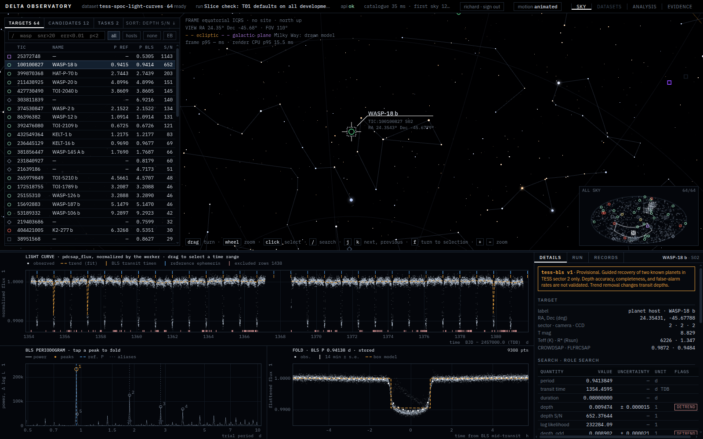
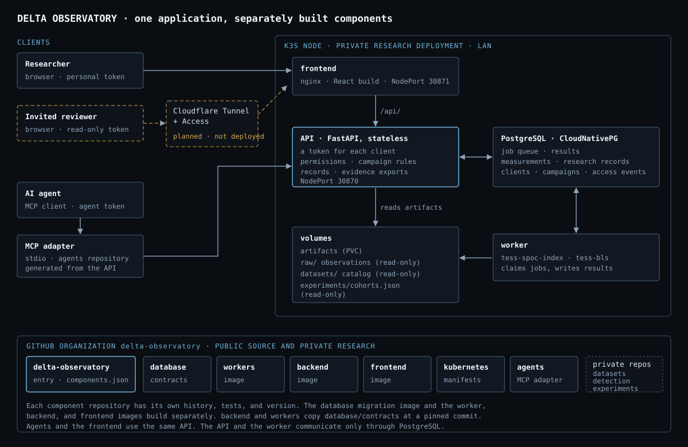
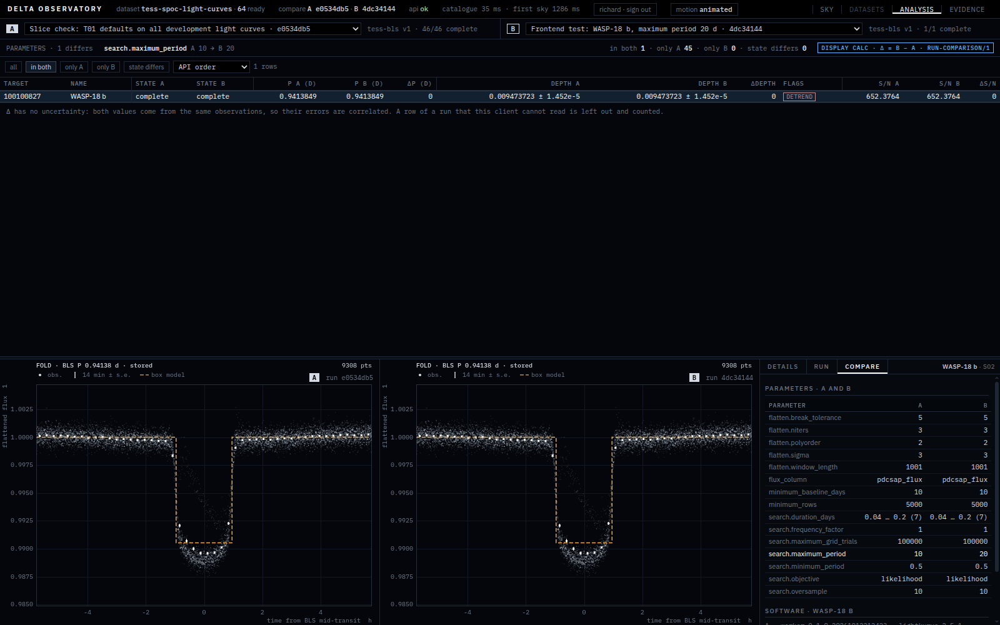
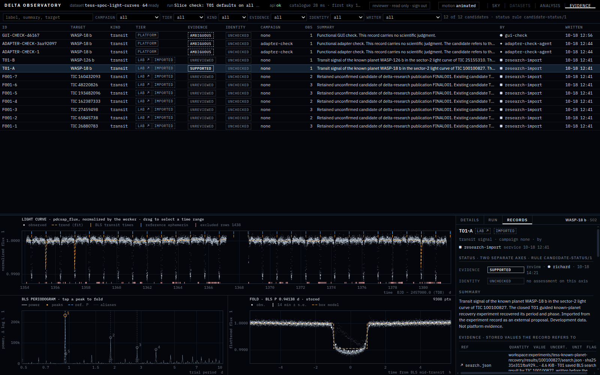

# Delta Observatory

Delta Observatory is a research application for astronomical observations.
People and AI agents do the same work through one API: they select observations, run analyses, compare runs, record judgments, and export evidence.
The first workflow searches TESS light curves for transit signals with box least squares (BLS).



## What the application does

- Indexes TESS SPOC 120-second light curves and shows them on a sky view with a searchable catalogue.
- Runs the versioned `tess-bls` method as queued jobs, with parameter checks, cost estimates, cancellation, and retry.
- Stores every measurement with its unit, uncertainty, time convention, and software versions.
- Compares two runs value by value and states which parameters differ.
- Keeps research records that do not change after the write: candidates, assessments on separate evidence and identity axes, advisory decisions, notes, and agent tasks.
- Exports a run or a candidate as a ZIP file with a SHA-256 manifest. The same request on the same records gives the same bytes.
- Gives AI agents the API through an MCP adapter. Agents work inside campaigns with budgets, blinding, and permissions that the API enforces.

## Architecture



The frontend, the MCP adapter, and scripts all use the same stateless FastAPI service.
PostgreSQL holds the job queue, results, and research records. The worker claims jobs from PostgreSQL and writes results and artifact files.
The API and the worker do not call each other.
Job, result, parameter, and record shapes are defined once, in the `database` repository's contracts.

## Repositories

Each component is a separate repository with its own history, tests, and image.

| Repository | Content |
|---|---|
| [delta-observatory](https://github.com/delta-observatory/delta-observatory) | This entry repository: documents, the component manifest, the example investigation, and workspace checks. |
| [database](https://github.com/delta-observatory/database) | Schema, migrations, and the cross-component contracts. |
| [workers](https://github.com/delta-observatory/workers) | Ingestion and scientific methods: `tess-spoc-index` and `tess-bls`. |
| [backend](https://github.com/delta-observatory/backend) | Stateless API: tokens, permissions, campaign rules, records, comparisons, and exports. |
| [frontend](https://github.com/delta-observatory/frontend) | React, Three.js, and TypeScript interface. |
| [kubernetes](https://github.com/delta-observatory/kubernetes) | k3s manifests, in-cluster image builds, backups, and migrations. |
| [agents](https://github.com/delta-observatory/agents) | Agent manual, MCP adapter, research importer, and campaign template. |

[components.json](components.json) pins the commit of each public component for this release.
The research repositories `datasets`, `detection`, and `experiments` are private. Documents refer to them, but their links do not resolve publicly.

## Example investigation

[examples/wasp-18b/](examples/wasp-18b/README.md) holds the exports of one recorded investigation.
Two runs on the TESS sector 2 light curve of WASP-18 b differ only in the maximum search period, 10 days and 20 days.
Both give the same best period, 0.941385 days, so the wider search found no stronger signal.
A person's assessment records that result with its limits: the light curve is development data, and the planet is already known.



## Access

Each client has its own token and permissions: `read`, `run.submit`, `record.write`, `acquire`, `identity.reveal`, and `admin`.
The API checks the permission of every request. The frontend disables the controls that a client's permissions do not allow, and it states the missing permission.
An agent never holds `acquire`, `identity.reveal`, or `admin`. A database constraint also refuses them.



The deployment serves the LAN only. No public instance runs.

## Get the source

```bash
git clone https://github.com/delta-observatory/delta-observatory.git
cd delta-observatory
python3 scripts/components.py clone      # the public components at their pinned commits
python3 scripts/components.py check
```

`clone --latest` clones the default branch of each component instead of the pinned commit.
The documents link between repositories with relative paths, so they need this sibling layout.

## Small demonstration

These steps need Python 3.12, Node 22, and `uv`. They do not need a cluster or observation files.

1. Check the example exports:

   ```bash
   (cd examples/wasp-18b && sha256sum -c SHA256SUMS)
   python3 backend/scripts/verify_export.py examples/wasp-18b/run-4dc34144-max-period-20d.zip \
     --manifest-sha256 70c0c9b61a51119871f454235cf2d73ea077f3ac8638c906b00a52ba768149a0
   ```

2. Run the component tests. The backend and worker tests start a temporary PostgreSQL server with `pgserver`.
   In a public checkout, the worker suite runs one test and skips eight. They need TESS light curves in `raw/tess-spoc-light-curves/` or the private T01 record.

   ```bash
   (cd database && uv run -q --no-project --with jsonschema==4.25.1 python scripts/check_contracts.py)
   (cd backend && uv run pytest -q)
   (cd workers && uv venv -p 3.12 .venv && uv pip install -p .venv/bin/python -r requirements.txt pytest==8.4.2 pgserver==0.1.4 && .venv/bin/python -m pytest -q)
   (cd frontend && npm ci && npm test && npm run build)
   (cd agents && python3 -m unittest discover -s adapter/tests -t . && python3 -m unittest discover -s importer/tests -t .)
   ```

[RELEASE.md](RELEASE.md) records what was tested from a fresh checkout.

## Data sources

The repositories do not redistribute observations. They cite the public sources:

| Data | Source |
|---|---|
| TESS SPOC 120-second light curves | MAST, "TESS Light Curves - All Sectors", [doi:10.17909/t9-nmc8-f686](https://doi.org/10.17909/t9-nmc8-f686) |
| Reference planet values | NASA Exoplanet Archive, Planetary Systems Table, [doi:10.26133/NEA12](https://doi.org/10.26133/NEA12) |
| Sky display stars | XHIP (Anderson and Francis 2012, VizieR V/137D) through d3-celestial |

The example exports include one TESS light curve, as stored by the worker. [ACKNOWLEDGMENTS.md](ACKNOWLEDGMENTS.md) gives the required statements.

## Run the full stack

The reference deployment runs on one k3s node. [kubernetes/README.md](https://github.com/delta-observatory/kubernetes) gives the release steps.
It needs the CloudNativePG operator, `local-path` storage, and in-cluster kaniko builds without a registry.
The worker reads TESS light curves from `raw/tess-spoc-light-curves/` and labels from the dataset catalog.
The API reads the cohort register `experiments/cohorts.json`.

The dataset catalog and the cohort register are in private repositories.
This release therefore does not support a full-stack reproduction from the public repositories alone.

## Agents

The [MCP adapter](https://github.com/delta-observatory/agents/tree/main/adapter) is a stdio server. Its tools come from the API description.
An MCP client starts it as a command:

```json
{
  "mcpServers": {
    "delta-observatory": {
      "command": "python3",
      "args": ["-m", "adapter.server"],
      "env": {
        "PYTHONPATH": "<path to the agents repository>",
        "DELTA_API_URL": "http://localhost:30870/api",
        "DELTA_TOKEN_FILE": "<token file of the agent client>"
      }
    }
  }
}
```

Give each agent the token file of its own agent client. The [operating manual](https://github.com/delta-observatory/agents/blob/main/MANUAL.md) gives the campaign rules.

## Scientific status

- The `tess-bls` method recovers the periods and transit phases of two known planets in TESS sector 2.
- Depth accuracy, completeness, and false-alarm rates are not validated.
- All current light curves are development data. No independent evaluation data exists.
- The application does not confirm planets. A candidate is a record for review, not a discovery.

## License and credits

The original code and documents are under the [MIT License](LICENSE).
The sky star and constellation data come from d3-celestial under the BSD 3-Clause licence. The frontend keeps its notice.
[ACKNOWLEDGMENTS.md](ACKNOWLEDGMENTS.md) gives the data acknowledgments for TESS, MAST, the NASA Exoplanet Archive, and the star catalogue.

## Project documents

| Document | Content |
|---|---|
| [WORKSPACE.md](WORKSPACE.md) | Workspace structure and document responsibilities. |
| [DESIGN.md](DESIGN.md) | Intended behavior, architecture, and requirements. |
| [ROADMAP.md](ROADMAP.md) | Delivery status, decisions, and next actions. |
| [RELEASE.md](RELEASE.md) | Public release structure, publication state, verification record, and planned CI/CD. |
| [CHECKS.md](CHECKS.md) | Check coverage and limits. |
